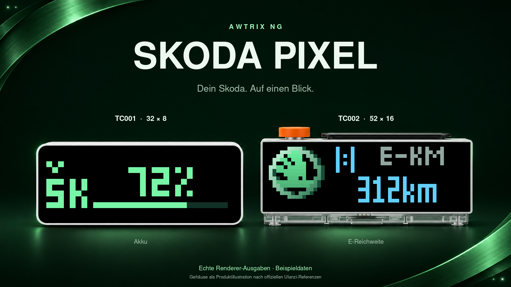

# Skoda Pixel — Erstveröffentlichung / Initial Release

## Deutsch

**Installer-Korrektur:** Die Uhrensuche startet nicht mehr beim Öffnen der Webseite, sondern ausschließlich auf ausdrückliche Benutzeraktion. Die erste Seite zeigt den tatsächlichen Suchstatus.

**Erste öffentliche Veröffentlichung von Skoda Pixel für Ulanzi TC001 und TC002 mit AWTRIX NG.**

Skoda Pixel bringt Informationen aus der öffentlichen Skoda Connect API direkt auf deine LED-Pixeluhr. Für beide Modelle gibt es eine eigene, auf die jeweilige Matrix abgestimmte Darstellung. Jede installierte Anzeige zeigt genau **einen ausgewählten Fahrzeugwert**; mehrere einzelne Anzeigen können in den normalen App-Wechsel von AWTRIX NG aufgenommen werden.

**Enthaltene Funktionen der Erstveröffentlichung:**

- **27 wählbare Einzelansichten je Uhrenmodell**, abhängig von den verfügbaren Fahrzeugdaten: unter anderem Akku, Reichweite, Ladezustand, Ladeleistung, Kilometerstand, Verriegelung und Klimatisierung.
- **Webbasierter Installationsassistent** für Neuinstallation und Aktualisierung.
- **Automatische Uhrenerkennung nach Klick auf „Uhren suchen“**, vorbelegt mit `192.168.178.0/24`, sowie manuelle IP-Eingabe.
- **Automatische Erkennung von TC001 und TC002** und passende Installation ohne Modellwahl.
- **Auswahl und Installation auf mehreren Uhren**, mit gesonderter Anmeldung nur bei geschützten Geräten und individuellen Ergebnissen.
- **Gemeinsamer Datenabruf je Uhr** über AWTRIX Shared statt einer eigenen Skoda-Abfrage pro Anzeige.
- **Einstellbares Abfrageintervall**, mit **60 Minuten als Standard**.
- **PNG-Vorschauen im Installer und getrennt archivierte GIF-Animationen** für beide Uhrmodelle. Die Animationen befinden sich im ZIP-Hauptverzeichnis unter `media/`.

**Jetzt installieren:** [Skoda Pixel Installationsassistent](https://q14six.github.io/SkodaPixel/)

Für den Betrieb brauchst du **Skoda-API-Key und VIN**. Browser können lokale Netzwerkzugriffe von GitHub Pages einschränken; dann steht das lokale Öffnen der heruntergeladenen `index.html` als Alternative bereit. Der Datenabruf garantiert weder Live-Daten noch, dass das Fahrzeug nicht aufgeweckt wird. Bei zwei Uhren erfolgen die Abfragen unabhängig voneinander.

Die vollständige Einrichtung und wichtige Sicherheitshinweise findest du in der [README.md](README.md).

---

## English

**Installer fix:** No local network scan runs when the page loads; discovery begins only after an explicit user action. The initial status correctly reflects the idle state.

**First public release of Skoda Pixel for Ulanzi TC001 and TC002 running AWTRIX NG.**

Skoda Pixel brings selected data from the public Skoda Connect API to your LED matrix clock. Each supported model has its own display layout, and each installed display app shows **one vehicle value**. Install multiple display apps and let AWTRIX NG handle their regular app rotation.

**Features in this initial release:**

- **27 selectable single-value views per clock model**, depending on vehicle data availability, including battery level, range, charging, odometer, locking and climate status.
- **Browser-based installation wizard** for initial setup and updates.
- **Automatic clock discovery after clicking “Uhren suchen”**, using `192.168.178.0/24` as the editable default, plus manual IP entry.
- **Automatic TC001/TC002 model detection** and model-specific installation.
- **Multi-clock installation**, with credentials requested only for protected devices and per-device completion feedback.
- **One shared Skoda data provider per clock** rather than one API request per display app.
- **Configurable polling interval**, **60 minutes by default**.
- **PNG previews for the installer and separately archived GIF animations** for both models. Animation files are kept in the top-level `media/` directory of the ZIP archive.

**Get started:** [Open the Skoda Pixel installer](https://q14six.github.io/SkodaPixel/)

A **Skoda API key and VIN** are required. Browser LAN access restrictions may require opening a downloaded copy of `index.html` instead of the hosted page. API responses may contain stored vehicle data, and requests cannot be guaranteed not to wake the vehicle. Each clock fetches independently.

See [README.md](README.md) for installation steps and security considerations.
